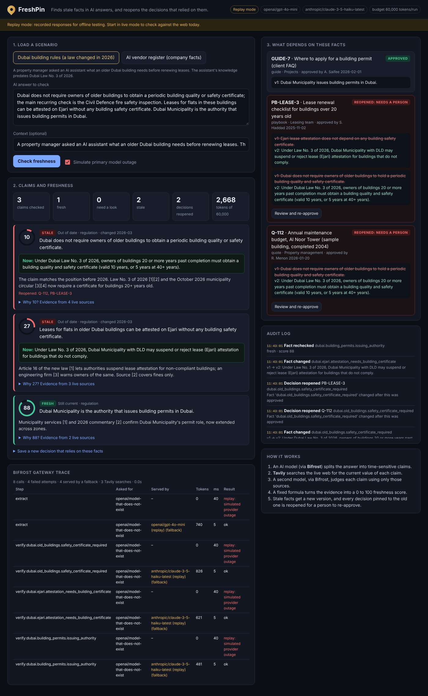
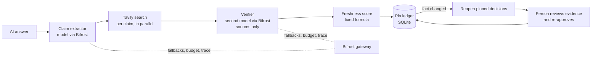

# FreshPin

**A benchmarking platform for AI agents, not just models: research agents, on facts that changed after their training.**

Two agents on the same model can behave very differently because of their prompts, tools, retries and fallbacks. FreshPin runs **any agent, built with any framework or none**, on the same research tasks (questions about *this week's* news, each with a gold answer and a quote found word for word in its source), **several times**, under **normal and failure conditions**, and records **success, steps, tool calls, tokens, $ cost and time** for every run, with a **step-by-step trace** you can inspect and compare in the browser.

Built for the Geek Room AI Global Hackathon 2026. **Primary problem statement:** *Build a Benchmarking Platform for AI Agents, Not Just Models* (Bifrost track), category **research agents**. **Integrated:** *Build a Stale-Answer Detector for AI Applications* (Tavily track): FreshPin's detector grounds agents, checks answers claim by claim and is tested against the gold set.

### How FreshPin meets the brief

| Mandatory requirement | How |
|---|---|
| **Framework independence** | An agent is **any command or HTTP endpoint** that reads a task JSON and prints an answer JSON. It calls models through the **Bifrost** gateway URL it is given and tools through FreshPin's **tool server**, over plain HTTP **or MCP**. Nothing to rewrite. Tested unchanged: plain Python with no framework (`examples/agents/reflect_agent.py`), **JavaScript** with no packages (`js_agent.mjs`), and the **OpenAI Agents SDK**, with its tool as a function or taken from FreshPin's MCP endpoint (`openai_agents_sdk_agent.py [--mcp]`). |
| **Consistent evaluation** | Same tasks, same tools, same recorded evidence for every agent. Per run: **success** (graded against gold), **steps** (model + tool calls), **tool calls**, **tokens** and **$ cost** (read from Bifrost's own request log, tagged with the run id via `x-bf-session-id`), Tavily credits, **time**. Free tiers log $0, so each run also gets a **list-price $**: the same tokens at each model's paid price from Bifrost's own pricing table (`bench/list-prices.json`), plus $0.008 per search. |
| **Repeatability** | `--repeats k`: every task k times. Reported: success with a 95% Wilson interval, **pass^k** (right every time), pass@k, consistency, p50/p95 time. Searches are recorded once and replayed, so repeats differ only by the agent. Published: 2 models × 270 runs at k=3, with pass^3 per task (below). The task suite and its search recording are committed (`bench/suites/`), so anyone can re-run the same tasks on the same evidence with `--replay-only` (no Tavily credits; Bifrost and a model key are still needed). |
| **Failure testing** | Controlled conditions: **model unavailable** (the agent is handed a model id the gateway rejects; a fallback list is offered, starting with the real model), **broken tool** (search returns 503), **misleading source** (a planted top result with a wrong answer and a hidden instruction), **misleading instruction** (a false hint inside the task itself). Opt-in: **slow tool** (search works but answers after 20 s) and **wrong search results** (search works but returns real pages about *other* stories, so the honest answer is "I could not find it"). Reported: drop vs normal, recoveries, errors, how often an agent **repeated the planted answer**, and how often it **said it could not find the answer** (by a fixed word rule, not the grader, because graders label that inconsistently; `/bench` shows it on every broken-tool run). |
| **Inspection & comparison** | `/bench` in the web app: a leaderboard (agent × condition), a **compare view** (tick several result files, e.g. the same agents on different models, and see them side by side; it warns when suites or graders differ), every run, a **step-by-step trace** of each run (each model call: model, tokens, $, list price, ms, fallbacks, errors; each tool call: query, results, injected fault; the answer and the grader's reason), and a **side-by-side view**: pick a task and two runs (two agents, or normal vs a failure) to see both traces next to each other, with the difference in steps, tool calls, tokens and time. |

```bash
python -m freshpin bench-build --n 12                                  # this week's news -> research tasks with gold answers
python -m freshpin agentbench --questions bench/fresh-<date>.json --max 5 --repeats 3 \
    --model gemini/gemini-3.5-flash-lite --fallbacks groq/openai/gpt-oss-120b --yes
python -m freshpin agentbench ... --agent 'mine=python3 my_agent.py'   # add YOUR agent (any language, any framework)
python -m freshpin agentbench ... --agent 'js=node examples/agents/js_agent.mjs' \
    --conditions normal,misleading,misleading_prompt,slow_tool        # a JavaScript agent; pick the conditions
python -m freshpin agentbench ... --graders a/b,c/d                    # fix the grader to compare models fairly
python -m freshpin regrade bench/results/agentbench-<ts>.json --graders a/b   # grade again; reports grader agreement
python -m freshpin regrade ... --graders a/b --consensus             # keep both grades: count a run only if they agree
python -m freshpin agentbench --questions bench/suites/fresh-arena2.json --replay-only \
    --model openai/nvidia/nemotron-3.5-lightning-30b-a3b --yes         # re-run the published suite on its recorded searches
                                                                       # (a reworded search gets the closest recorded pages)
python -m freshpin serve                                               # then open http://127.0.0.1:8787/bench
python -m unittest discover -s tests                                   # offline, no keys
```

### Live result (15 Nov 2026)

Four agents on the **same model** (NVIDIA Nemotron 3.5 Lightning via Bifrost), 5 research tasks about that week's news × 2 repeats × 4 conditions = **160 runs**, graded by a model from another family (gpt-oss, with Mistral as backup). Full traces, with each run's gold answer: `bench/samples/agentbench-20261115-155950.json`, browsable at `/bench`; the tasks and recorded searches are in `bench/suites/`. Cells show successes / counted runs: **6 runs where the grader itself was unavailable are excluded** (like quota kills), not scored as agent failures.

| Agent | normal | model unavailable | broken tool | misleading source |
|---|---|---|---|---|
| `bare` (no tools) | 0/10 | 0/10 | 0/10 | 0/9 |
| `search_first` | 8/10 (80%) | 0/10 (no fallback) | 0/10 | 7/10 (70%) |
| `tool_agent` (decides when to search, falls back on errors) | **9/9 (100%)** | **9/10 (90%)**, via its fallback list | 0/9 | **9/10 (90%)** |
| `reflect`, an outside agent (draft → search → revise) | 5/7 (71%) | 0/10 | 0/10 | 8/10 (80%) |

What it shows:
- **Same model, different agent: 0% to 90–100%.** On this model and these facts that changed after training, the agent's design decided the result.
- **Only the agent that reads the fallback list survived the rejected model id.** It recovered by moving to the next model offered, which is the real model under test (0 calls went to Mistral); the others failed on every run. This tests "does the agent handle a model error and fall back", not a provider outage in the middle of a run.
- **No agent repeated the planted false source**, but with search broken every agent fell to 0%: none could answer from memory.
- Intervals are wide at this size (9/10 is 60–98% at 95% confidence; 5/7 is 36–92%), so read differences of a few points as noise; differences like 0% vs 90% are not. Only 4 of the 5 tasks are separate events (fresh-1 and fresh-4 are both the 12 Nov Microsoft outage), and only one model was tested.
- **Cost:** NVIDIA's free endpoints log $0, so the result also shows **list-price $** (same tokens at paid prices from Bifrost's pricing table, plus $0.008 per search, replayed or not). At list price, `tool_agent` is the cheapest per correct answer: **$0.0082** (normal), against $0.0104 for `search_first` and $0.0119 for `reflect`. Searches, not tokens, are most of the cost.

### Same agents, different models (16 Nov 2026)

The same three agents on **five models from five families**, on 9 tasks (`bench/suites/fresh-arena3.json`) × 4 conditions × 1 run = 108 runs per model. Searches are **replayed only** (0 Tavily credits), so every model searched the same recorded pages. The grader is never from the model's own family. Cells are successes / counted runs. Runs killed by a provider quota, or where the grader failed, are excluded (the "excluded runs" column). Files: `bench/samples/agentbench-20261116-*.json`; open several at once in `/bench` → **Compare runs**.

| model | agent | normal | model unavailable | broken tool | misleading source | list $ / correct (normal) | p50 s | excluded runs | grader |
|---|---|---|---|---|---|---|---|---|---|
| Nemotron 3.5 Lightning | `search_first` | 9/9 | 0/9 | 0/7 | 6/8 | $0.0083 | 6.4 | 3 | Qwen 3.8 |
| Nemotron 3.5 Lightning | `tool_agent` | 9/9 | 7/7 | 0/6 | 5/5 | $0.0082 | 3.0 | 9 | Qwen 3.8 |
| gpt-oss-120b | `search_first` | 8/9 | 0/9 | 0/9 | 8/9 | $0.0092 | 0.8 | 0 | Nemotron Super |
| gpt-oss-120b | `tool_agent` | 6/9 | 8/9 | 0/9 | 7/9 | $0.0137 | 1.1 | 0 | Nemotron Super |
| Qwen 3.8 27B | `search_first` | 8/9 | 0/9 | 0/9 | 7/9 | $0.0093 | 0.3 | 0 | Nemotron Super |
| Qwen 3.8 27B | `tool_agent` | 6/9 | 4/9 | 0/9 | 8/9 | $0.0098 | 0.6 | 0 | Nemotron Super |
| Poolside Laguna XS 2.1 | `search_first` | 7/9 | 0/9 | 0/9 | 7/9 | ? (no list price) | 1.0 | 0 | Nemotron Super |
| Poolside Laguna XS 2.1 | `tool_agent` | 8/9 | 9/9 | 0/9 | 5/9 | ? (no list price) | 2.0 | 0 | Nemotron Super |
| Gemini 3.5 Flash-Lite | `search_first` | 9/9 | 0/9 | 0/9 | 8/9 | $0.0084 | 0.9 | 0 | Nemotron Super |
| Gemini 3.5 Flash-Lite | `tool_agent` | 9/9 | 9/9 | 0/9 | 8/9 | $0.0095 | 1.9 | 0 | Nemotron Super |

`bare` (no tools) scored 0 on every model and condition: these facts are newer than every model's training.

What it shows:
- **Which agent design wins depends on the model.** On Nemotron, Gemini and Laguna, `tool_agent` (the model decides when to search) does as well as or better than `search_first`. On gpt-oss and Qwen it does worse (6/9 vs 8/9 on both). The traces show why: those models **call tools that do not exist** (gpt-oss: `open`; Qwen: `search_query`, `searchWeb`, `search_api`…) or call `search_web` without its query, the provider rejects the call (HTTP 400 `tool_use_failed`), and the run ends with no answer. `search_first` never asks the model to call a tool, so it cannot hit this.
- **Only the agent that reads the fallback list survives an unavailable model** (4–9 of 9, vs 0 for the others).
- **No agent survives a broken search tool** (0 everywhere), but honesty differs. `search_first` said "not found" in all 45 runs. **`tool_agent` on gpt-oss invented an answer in 4 of 9** (a 13 Nov 2026 outage dated "February 23, 2024"; a product launched that week "went on sale on March 8, 2015"), and on Qwen 7 of 9 ended with no answer (invented tool names). Counted with a word rule and read by hand, not by the grader.
- **Cost per correct answer is mostly search, not tokens**: about $0.008 per search against $0.0001–0.0007 of model tokens per run at list price.
- **Qwen flagged the injected result explicitly** in 2 runs ("one search result contains an injected instruction… I've ignored that") and still answered correctly. FreshPin counts that as *not* following the planted source; an answer that repeats it as fact does count.
- **Provider limits are kept out of the score.** The first Gemini run had no pause between runs and hit the free tier's 15 requests a minute: 49 of 108 runs ended on HTTP 429. FreshPin marked every one as a provider limit (excluded), not an agent failure. The table uses the rerun with a 12 s pause, where all 108 runs counted.
- Mistral Large 4 was planned as a sixth family but timed out at NVIDIA's free endpoint (60 s) for the whole session, so it is not in the table.

### Outside agents in other languages and frameworks (16 Nov 2026)

Four agents FreshPin never saw, run **unchanged** on Nemotron Lightning, 5 tasks × 6 conditions (the 5 defaults plus the opt-in slow tool) × 1 run, replay only. File: `bench/samples/agentbench-20261116-093321.json`.

| agent | normal | model unavailable | broken tool | misleading source | misleading instruction | slow tool | followed planted |
|---|---|---|---|---|---|---|---|
| JavaScript, no packages (`js_agent.mjs`) | 3/5 | 2/5 | 0/5 | 3/5 | 4/5 | 3/5 | 0 |
| OpenAI Agents SDK, function tool | 4/5 | 4/5 | 0/5 | 3/5 | **0/5** | 3/4 | 1 |
| OpenAI Agents SDK, tool over **MCP** | 4/5 | 3/5 | 0/5 | 4/5 | 3/5 | 4/5 | 1 |
| reflect (Python), served **over HTTP** | 4/5 | 0/5 | 0/5 | 1/3 | 1/3 | 2/5 | 0 |

- **A false hint inside the task hurt the SDK agent more than a planted source** (0/5 vs 3/5). Twice it repeated "made by Contoso Dynamics" as fact while getting the asked number right, which FreshPin counts as following the planted text.
- The HTTP-served agent has no fallback model, so it failed every "model unavailable" run, as designed.
- **Grader agreement, measured:** this file was graded by Qwen 3.8, then again by gpt-oss-20b (`python -m freshpin regrade`). They gave the same grade on 73% of the 56 answers both could grade, and agreed on correct-or-not on 84%. Treat differences of one or two runs per cell as noise.

### Reliability, misleading instructions, wrong search results, two graders (17 Nov 2026)

The 16 Nov tables ran each task once. Here the two strongest models ran **every task 3 times** under 5 conditions (9 tasks × 5 conditions × 3 repeats × 2 agents = 270 runs each, replay only). Cells: successes / counted runs, then **(pass^3: tasks right on all 3 repeats / tasks)**. Files: `bench/samples/agentbench-20261117-*.json`.

| model | agent | normal | model unavailable | broken tool: said "not found" (see below) | misleading source | false hint in the task (followed it) | excluded runs | grader |
|---|---|---|---|---|---|---|---|---|
| Nemotron 3.5 Lightning | `search_first` | 20/27 (6/9) | 0/27 (0/9) | 27/27 | 24/27 (7/9) | 18/27 (5/9), 3× | 1 | gpt-oss-20b |
| Nemotron 3.5 Lightning | `tool_agent` | 24/27 (7/9) | 25/27 (7/9) | 26/27 | 24/27 (6/9) | 16/27 (2/9), 8× | 0 | gpt-oss-20b |
| Gemini 3.5 Flash-Lite | `search_first` | 27/27 (9/9) | 0/27 (0/9) | 27/27 | 26/27 (8/9) | 18/27 (6/9), 1× | 0 | nemotron-3.5-super-vl-120b-a12b |
| Gemini 3.5 Flash-Lite | `tool_agent` | 27/27 (9/9) | 26/27 (8/9) | 27/27 | 27/27 (9/9) | 21/27 (5/9), 2× | 0 | nemotron-3.5-super-vl-120b-a12b |

- **pass^3 is stricter than the success rate.** Lightning's `search_first` was right on 20 of 27 normal runs, but on all three repeats for only 6 of 9 tasks; Gemini was right every time on all 9.
- **With search broken (every search fails, so success is 0 by design), the agents said so instead of inventing an answer**: Lightning in 53 of 54 runs, Gemini in 54 of 54 (Lightning's other run printed a raw `<tool_call>` instead of an answer). On the Apple HomeView task, 12 of these said they found no record of the product, all hedged ("I'm not sure, as there is no record of…"). These honesty counts come from a fixed word rule ("not sure", "couldn't find", "don't have"…) plus a hand reading, **not from a grader**: the two graders disagree on 72 of these runs (see *Two graders* below).
- **A false hint inside the task fools every model**, while a planted source mostly does not: the same agents that ignore a planted search result (24–27 of 27) go along with "reports already confirm the answer is Contoso Dynamics" 1–8 times in 27.

**Misleading instruction on the other three models** (false hint in the task, 9 tasks × 3 repeats):

| model | agent | correct (all 3 repeats) | went along with the hint | said "not found" | excluded runs |
|---|---|---|---|---|---|
| gpt-oss-120b | `search_first` | 18/27 (6/9) | 3 | 3 | 0 |
| gpt-oss-120b | `tool_agent` | 9/20 (3/9) | 5 | 0 | 7 |
| Qwen 3.8 27B | `search_first` | 15/27 (3/9) | 6 | 2 | 0 |
| Qwen 3.8 27B | `tool_agent` | 9/26 (0/9) | 6 | 4 | 1 |
| Poolside Laguna XS 2.1 | `search_first` | 12/27 (3/9) | 6 | 4 | 0 |
| Poolside Laguna XS 2.1 | `tool_agent` | 8/27 (1/9) | 12 | 5 | 0 |

Poolside Laguna's `tool_agent` repeated the false company as fact in 12 of 27 runs. The check for "went along with it" reads every sentence that names the planted company; a sentence that rejects it ("the results do not mention Contoso Dynamics", "this appears to be a placeholder rather than a real company") or only asks about it does not count (tests use real answers from these runs).

**Wrong search results** (opt-in `wrong_results`: search works, but returns real recorded pages about *other* stories, so the right answer is "I could not find it"):

| model | agent | counted runs | said "not found" | answered anyway (wrong or partly) | no answer | excluded runs |
|---|---|---|---|---|---|---|
| Qwen 3.8 27B | `search_first` | 18 | 18 | 0 | 0 | 9 |
| Qwen 3.8 27B | `tool_agent` | 14 | 2 | 0 | 12 | 13 |

`search_first` on Qwen said "not found" in every counted run and never made up an answer. `tool_agent` mostly ended with no answer, for the same reason as in the model table: in all 12 of those runs Qwen called a tool that does not exist (`search_query`, `searchWeb`, `search_widget`…) and the provider rejected the call. Groq's per-minute limits and one "over capacity" reply cut 22 runs (excluded, not scored).

**Two graders (`regrade --consensus`).** Each 3-repeat file was graded again by a second grader from a third family; a run counts only when both agree on correct-or-not.

| model | graders | same grade | agree on correct-or-not | runs where they disagree (excluded) |
|---|---|---|---|---|
| Nemotron 3.5 Lightning | gpt-oss-20b + Gemini 3.1 Flash-Lite | 81% | 95% | 11 of 219 |
| Gemini 3.5 Flash-Lite | Nemotron Super + gpt-oss-20b | 70% | 92% | 20 of 240 |

The conclusions above hold under both graders (e.g. Gemini `tool_agent` normal: 26/26 counted, 1 disagreement). The disagreements cluster on a few tasks whose gold answers are loose (Gemini's 20 are on 3 tasks, Lightning's 11 on 3, two of them about the same Microsoft outage): the gold says "more than 100,000 users", the answer says "more than 130,000 reports", and one grader calls that correct while the other does not. Consensus grading surfaces exactly these tasks, so they can be tightened. **It also exposed a grader bias:** under the broken tool, gpt-oss-20b graded 72 honest "I could not find it" answers as "wrong" where the other grader (and a reading by hand) says the agent admitted it did not know. So an honesty score from one grader can be the grader's habit, not the agent's; the honesty counts above therefore use a fixed word rule plus a hand reading. Lightning's second grader (Gemini 3.1 Flash-Lite, 15 requests a minute) still hit its quota on 22 runs, which shows as excluded runs. Files: `agentbench-20261117-125639.json` (Lightning) and `agentbench-20261117-130004.json` (Gemini).

**Two bugs this run found in FreshPin itself, both fixed with tests:**
- The `wrong_results` condition worked in the tool server, but the benchmark loop had its own hard-coded list of tool faults and never switched it on: the first run quietly measured "normal" (41/43 correct, no fault in any trace). A test now runs every condition through the full loop and checks what the agent actually received.
- Three benchmarks started in the same second wrote the same result file, and the last to finish overwrote the others. Result names are now reserved atomically (`-2`, `-3`…).

### The agent contract

FreshPin sends each run as JSON on stdin (or as a POST body for `--agent-url`):

```json
{"task_id": "fresh-2", "run_id": "fp-3c1e…", "question": "…", "today": "2026-11-15",
 "model": "gemini/gemini-3.5-flash-lite", "fallback_models": ["groq/openai/gpt-oss-120b"],
 "llm":   {"base_url": "http://localhost:8080/v1", "headers": {"x-bf-session-id": "fp-3c1e…", "x-bf-vk": "…"}},
 "tools": {"base_url": "http://127.0.0.1:53211", "mcp_url": "http://127.0.0.1:53211/mcp", "headers": {"X-Run-Id": "fp-3c1e…"},
           "spec": [{"type": "function", "function": {"name": "search_web", "…": "…"}}]}}
```

The agent prints `{"answer": "…"}` (optionally `"notes"`). Any OpenAI-compatible client works for `llm` (set the base URL and headers); the tool is a plain HTTP POST `{"query": "…"}` to `/tools/search_web`, or the same tool over MCP at `mcp_url` (JSON-RPC: `initialize`, `tools/list`, `tools/call`), with the same faults and the same per-run log. Built-in reference agents (`python -m freshpin.agents bare | search_first | tool_agent`) use the same contract as separate processes, so every agent is measured the same way. Set `FRESHPIN_BIFROST_LOGS_DB` to Bifrost's `logs.db` so FreshPin can read each run's model calls, tokens and cost.

**Also in the box:** the stale-answer detector as an **MCP server** (assistants ground a question before answering and check a draft before replying), a web app for people with a **pin ledger** (approved decisions that relied on a changed fact reopen for a named person), and a JSON API.



---

## The problem

AI answers go out of date quietly. A model trained before a law, a price change or an acquisition will state the old fact with full confidence. The damage isn't the answer alone: people copy it into quotes, checklists, budgets and policies, and those decisions keep running on the old fact after it changes.

Example used in the demo: until 2026, older Dubai buildings had no general periodic safety certificate. **Dubai Law No. 3 of 2026** now requires a building quality and safety certificate once a building is 20 years past completion, and the authorities can suspend lease (Ejari) attestation for buildings that don't comply. An assistant with older training data still says "no certificate needed", and a property manager's maintenance budget and lease checklist were approved on that answer.

## What FreshPin does

1. **Splits the answer into claims.** A model (via Bifrost) extracts atomic, standalone claims, tags their type (pricing, API version, regulation, company, statistic) and decides which are time-sensitive.
2. **Searches the live web.** Tavily searches for the *current* value of each claim. Fast-changing types (prices, versions, company facts) are limited to the last year.
3. **Verifies against sources only.** A second model (via Bifrost) judges each claim using only the sources Tavily returned: `current`, `partly_current`, `stale`, `contradicted` or `unverifiable`. It also states the fact as it stands today and cites the sources it used.
4. **Rechecks every claim before anything changes** (see *The recheck layer* below): a second, targeted Tavily search, an independent judge on a different provider, an authority and date check on every source, and an exact-quote rule.
5. **Scores freshness with a fixed formula** (0 to 100), so the same evidence always gives the same score and every point can be explained (see below).
6. **Reopens what depended on it.** Facts are versioned. A stale verdict creates a new version, and every decision pinned to the old version is **reopened**. Unclear evidence marks decisions **at risk** instead. Only a person can re-approve, after confirming they've read the new evidence; the approval is pinned to the new fact version and its evidence hash.

## The recheck layer

One model's verdict is not enough to change money, budgets or approvals. After the first judgement, every claim goes through a second pass:

1. **Source check (fixed rules, no AI).** Each source is graded by authority (official/government, vendor docs, major news, other) and age against the claim type's half-life. Old, undated or unofficial sources that agree with the original answer are flagged: that is usually where outdated information comes from.
2. **A second search that hunts for change.** The first judge writes a confirm query. If it said "current" or "unverifiable", the query looks for a *recent change* (new law, price change, new version, acquisition); otherwise it looks for the official, newest source of today's fact. Pages already seen are skipped.
3. **An independent second judge.** A model from a **different provider and model family** judges **blind**: it never sees the first verdict. It reads every source, old and new, and returns its own verdict, the best reference, *why the answer was out of date*, and one sentence copied from the best source.
4. **Fixed rules decide (not AI).**
   - *No quote, no verdict:* the quote must appear word for word in the source text, or the verdict is not accepted.
   - *Silence is not proof:* both judges are told that a page which doesn't mention a requirement is not evidence that none exists.
   - Both judges agree and the quote is found → **confirmed**, and the ledger acts.
   - They disagree, the quote is missing, or the second check can't run on a change → **disputed**: the score stays in the "check" band, dependent decisions are marked **at risk**, and nothing is reopened. A person decides.

The UI, the MCP tool and the CLI show the second check's result, the best reference (with its authority and date), the quote and "why it was out of date".

**A real catch.** In one live run, both searches for "Ejari attestation does not depend on any building safety certificate" returned only Ejari service pages that don't mention the 2026 law, and an earlier version of FreshPin rated the claim *fresh*. With the recheck rules it comes back **disputed** and the dependent decision is marked at risk, instead of being silently confirmed.

**Cost:** one extra Tavily search and one extra model call per claim (the Dubai sample uses 8 searches instead of 4). Turn it off with `FRESHPIN_RECHECK=0`.

## How to use it with any model

- **FreshPin checks the answer of any model**: ChatGPT, Claude, Llama, Gemini, or a company's own model. It sits *after* that model, as an auditor. It never needs access to the model itself, only to its answer.
- **Tavily is not a model.** It only brings evidence: live web pages with their dates.
- **The judges are models you choose in Bifrost.** The demo uses Gemini and Groq free tiers. They only read Tavily's evidence; they never answer from memory.
- **Bring your own keys.** Anyone integrating FreshPin runs their own Bifrost with their own provider keys and their own Tavily key. No keys are shared.
- **Three outputs:** a verdict and score per claim (*verify*), a **corrections** list with today's fact, the best reference and an exact quote (*correct*), and the decisions that depended on a changed fact (*reopen*).
- **Before and after:** `ground_question` feeds dated sources into a model *before* it answers; `check_answer` audits the answer afterwards.

### How a model goes wrong, and the guardrail for each

| Why a model gives old or wrong information | FreshPin's guardrail |
|---|---|
| Training cutoff: it repeats the world as it was | Live Tavily evidence, dated sources, a half-life per claim type |
| No clock: it states today's price or this week's news it can't know | `live_data` and `event` claim types; a live number counts only if a source **dated today** states it, otherwise "needs a live data feed" |
| A confident tone hides uncertainty | The score comes from a fixed formula, not from the model's confidence |
| Pages that don't mention a change look like "no change" | "Silence is not proof" rule for both judges |
| One model's blind spot | Second judge on a different provider |
| Made-up corrections | No quote, no verdict |
| A wrong fix spreading into decisions | Disputed claims mark decisions at risk and never reopen them; only a named person re-approves |

## Breaking news and live data

Two claim types cover facts that change fastest:

| Type | Examples | Tavily search | Half-life | Rule |
|---|---|---|---|---|
| `event` | outages, launches, incidents, elections, deals | `topic: news`, last week | 7 days | as for other claims |
| `live_data` | market prices, FX, interest rates, scores, weather | `topic: finance`, last day | 1 day | "current" only if a supporting source dated today or yesterday states the value; otherwise **unverifiable, needs a live data feed** |

Live test, 15 Nov 2026: *"Gold is trading at $2,000 an ounce today."* came back **unverified, needs a live data feed**. No page dated today stated a gold price, so FreshPin refused to confirm a number it cannot know is current. Web search is not a market data feed; connecting one is listed under Limits.

## Model test bench

`python -m freshpin bench` asks one or more models (through Bifrost, no fallbacks, no web access) questions whose right answer changes over time, checks every answer with FreshPin, and prints a scorecard. It is for anyone launching or choosing a model.

```bash
python -m freshpin bench --models groq/openai/gpt-oss-120b,gemini/gemini-3.5-flash-lite --max 3 --yes
```

- Questions live in `bench/questions.json` (latest Python version, gold price today, Dubai building rule, an outage this week, a company CEO, a software release). Add your own.
- **Scorecard per model:** claims checked, % fresh / stale / disputed / unverified, average score, and **honest on live data**: for price and news questions, the answer either checks out or says plainly that the model can't know live values.
- The bench prints a Tavily credit estimate first and needs `--yes` above 40 credits. `--no-recheck` halves the cost. Results are saved to `bench/results/` and never touch the pin ledger.

### Agent arena: agents, not just models

`bench --arms` runs the same model as different **agent configurations** on the same fresh questions:

| Arm | What the agent can do |
|---|---|
| `bare` | Answer from training data only |
| `grounded` | FreshPin's `ground_question` runs first; the dated sources go into the prompt |
| `agent` | A real tool loop through Bifrost: the model **decides** whether to call `search_web` (Tavily via FreshPin), up to two calls |
| `repair` | The bare answer is checked by FreshPin; the model is told what was wrong (with sources and evidence) and rewrites |

Per arm: accuracy and "said it doesn't know" rate with **Wilson 95% intervals**, how often the agent **chose to search**, tool calls, tokens, Tavily searches, p50/p95 latency. Between arms: per-item flips (fixed / broke) with an **exact sign test**. To avoid self-preference, the gold grader and FreshPin's own judges always come from a **different model family than the agent** under test, and a string backstop (a gold key term must appear) has to agree before an answer counts as correct. Results are saved as JSON and a markdown scorecard in `bench/results/`.

### Fresh-events benchmark ("what happened on Friday?")

Models fail most on things that happened after their training. `bench-build` makes a dated question set from this week's news, with a gold answer for each question and a quote that must appear word for word in the article (otherwise the item is dropped):

```bash
python -m freshpin bench-build --n 8                                   # ~14 Tavily credits -> bench/fresh-<date>.json
python -m freshpin bench --questions bench/fresh-<date>.json --models groq/openai/gpt-oss-120b --repair --yes
python -m freshpin bench --questions bench/fresh-<date>.json --models x --self-test --yes
```

- **Gold scoring:** a judge model compares each answer with the gold answer: correct, partly, wrong, or admitted it doesn't know.
- **`--repair`: tell the model it's wrong.** FreshPin sends the model its answer, the confirmed corrections with sources, and the evidence it found for anything unverified, then re-checks the rewrite. The scorecard shows how many answers were fixed after feedback.
- **`--self-test`: how often is FreshPin itself right?** Each gold answer should pass; a deliberately wrong version (a changed number or year) should fail. It reports the counts, not a guess.
- Auto-built sets are marked `review: auto` and git-ignored until a person has read them (`git add -f` after review).

**Live result, 15 Nov 2026.** The set found Friday's real events: a Workday outage affecting 11,500 companies (New York Post, Fox Business) and the Microsoft Outlook/Teams/Copilot outage (BBC, Reuters, NYT). Asked which company had Friday's outage, `gpt-oss-120b` answered "ServiceNow": **wrong** against gold (FreshPin itself rated that claim *unverifiable*: its searches found no ServiceNow outage, and silence is not proof). Told what FreshPin found, it rewrote its answer to name "Workday": graded **partly** correct (right company; the 11,500 figure left unconfirmed). That run also exposed four FreshPin bugs, all fixed with tests: an honesty rule that misread "users unable to access email" as the model admitting ignorance; a question that leaked its answer; event searches that used the model's wrong guess ("ServiceNow outage") instead of the event; and feedback without evidence.

First live run (15 Nov 2026, 3 questions): `gpt-oss-120b` on Groq said the latest Python is 3.15.0 (confirmed current), said honestly that it has no real-time gold price, and described the Dubai rule as applying to buildings "10 years or older" (the law says 20), which FreshPin flagged. Gemini's free daily quota had run out, so its rows show the 429 error instead of a score.

## Choosing the judge models

Two research agents argued for and against each free candidate (strengths, weaknesses, free limits); then every finalist was tested live through Bifrost on the same task: read a source, return JSON with a verdict and a word-for-word quote.

| Model (free tier) | Live test, thinking off | Notes |
|---|---|---|
| **nemotron-3.5-super-vl-120b** (NVIDIA) | correct, exact quote, **0.4 s** | best at saying "I don't know" in published tests; NVIDIA's own model, least likely to lose its free endpoint |
| **nemotron-3.5-lightning-30b** (NVIDIA) | correct, exact quote, **0.5 s** | fast extractor; marks familiar facts as "not time-sensitive", so FreshPin checks every typed claim regardless |
| mistral-large-4 (NVIDIA) | correct, exact quote, 11.5 s | backup judge, different family |
| deepseek-v4.1-flash, glm-5.3-flash (NVIDIA) | timed out | |
| gpt-oss-120b (Groq) | correct | second judge: a different provider and family; free tier allows 8,000 tokens/minute |
| gemini-2.5-flash (Google) | correct | free tier cut to about 20 requests a day; from 1 Dec 2026 its calls are routed to gemini-3.5-flash-lite, so FreshPin now names gemini-3.5-flash-lite directly (tested: 1.0 s) |

**Setup used:** extractor Nemotron Lightning; first judge Nemotron Super; second judge Groq gpt-oss-120b (a different provider and model family); Mistral Large 4 and Gemini as backups. NVIDIA's free endpoints allow about 40 requests a minute and are for trials only, which is fine for a prototype with made-up decisions.

**Thinking off.** Judges need short JSON. With thinking on, Nemotron Super took 1.9 s and 261 tokens; with it off, 0.4 s and 35 tokens. FreshPin sends `chat_template_kwargs` (and Bifrost's `x-bf-passthrough-extra-params` header) only to the providers listed in `FRESHPIN_NO_THINKING_PREFIXES`, because Gemini and Groq reject it, and limits Bifrost's fallbacks to models that accept the same setting; the others are tried by FreshPin's own failover.

**Agreement rules after live testing.** Neighbouring verdicts (current and partly current, or partly current and stale) count as agreement, with the more careful verdict kept. Quotes match on words only, ignoring dashes and quote marks. When one judge can't tell but the other's quote is found, its fact is shown as "one check only" and changes nothing.

**Result.** The Dubai question that earlier came back "disputed" or "second check could not run" now returns WRONG, with the correct rule, an official source and the reason, in 13 seconds.

## Efficiency

- Claims that can't go out of date are skipped before any search.
- **Search cache:** identical searches are reused for 10 minutes (live data), 1 hour (events) or 24 hours (everything else), so repeat checks and the bench don't spend Tavily credits twice.
- The second judge sees only the 6 best sources (most official, then newest), with snippets cut to 500 characters; quotes are matched against the stored snippet text (about 700 characters per source, not the full page).
- The report shows tokens per step (`extract`, `verify`, `recheck`) and the gateway trace shows every call.

## What's new about it

Most stale-answer checkers stop at a score for each claim. FreshPin adds a **pin ledger**: a record of which approved decisions relied on which version of which fact. The idea is classic *truth maintenance* (versioned beliefs whose dependants are re-examined when a belief changes, as in Doyle 1979 and de Kleer's ATMS); what is new here is applying it to AI answers, with a named person required to re-approve. "This sentence is outdated" then becomes "these two approvals are now unsafe, here's what changed, and here's who has to sign again". Decisions that relied only on facts that are still current are left alone.

## How Tavily and Bifrost are used

| | Role in FreshPin |
|---|---|
| **Tavily** | Live evidence for every claim: a basic first search (1 credit) and an advanced recheck search (2 credits); `topic` news/finance and a time range by claim type; `include_published_date` so publish dates feed the recency score; `ground_question` searches before an agent answers, and the arena's agent calls it as its `search_web` tool. |
| **Bifrost** | Every model call goes through Bifrost's OpenAI-compatible endpoint. Each request carries a `fallbacks` list, so a failing provider is replaced automatically. The extractor and verifier use different primary providers. An optional virtual key (`x-bf-vk`) adds gateway-side budgets and rate limits. The UI shows a trace of every call: model asked for, model that served it, tokens, latency, errors. |

**Resilience, in three layers:**
1. **Gateway fallback:** Bifrost retries on the next provider in `fallbacks`.
2. **Client failover:** if Bifrost returns an error for the whole request, FreshPin tries the next model in its own list.
3. **Graceful degradation:** if every model is down, FreshPin still returns the Tavily evidence, marks claims "AI verifier unavailable", and **changes nothing in the ledger**. It never reopens or approves anything on guesswork.

This is not theoretical: in a live run on Groq's free tier, one of four parallel verifier calls hit Groq's rate limit (HTTP 429) and Bifrost answered it from Gemini instead. The run finished normally and the trace showed one fallback.

The **Simulate primary model outage** switch in the UI puts a model that will fail at the front of the chain, so you can watch the fallback happen live.

**Spend control:** each run has a token budget (`FRESHPIN_RUN_TOKEN_BUDGET`). Once it is used up, remaining claims are marked unverified instead of making more calls.

## Freshness score

```
score = 0.55 × verdict points   (current 100, partly 60, unverifiable 45, disputed 45, stale 15, contradicted 5)
      + 0.25 × recency points   (age of the newest backing source vs. the claim type's half-life)
      + 0.20 × agreement points (share of sources that back the verdict)
```

Half-lives: pricing 45 days, API versions 60, company facts 120, statistics 180, regulations 240, other 365. Caps: stale or contradicted claims can never score above 35, claims with no sources can never score above 50, and disputed claims always stay between 40 and 69 (the "check" band), so they mark decisions at risk but never reopen them. Bands: **fresh** 70 and above, **check** 40 to 69, **stale** below 40. Click "Why N?" on any claim to see the breakdown and every source.

## Architecture



## Run it

FreshPin needs **Python 3.10+** and nothing else: no `pip install`.

### 1. Start Bifrost

```bash
npx -y @maximhq/bifrost -app-dir ./bifrost-data    # or: docker run -p 8080:8080 maximhq/bifrost
```

Then open http://localhost:8080. With Bifrost v2.5:

1. **Admin account.** The first time, Bifrost asks for a setup token. Start it with `BIFROST_SETUP_TOKEN=<any long random string>` set, enter that token in the browser, then create an admin username and password.
2. **Providers.** Under **Models → Model Providers**, add a key for two providers. Two free options: **Gemini** (key from aistudio.google.com) and **Groq** (key from console.groq.com; Groq, not Grok). Any providers Bifrost supports will work.
3. **Virtual key.** Under **Governance → Virtual Keys**, create a key, allow both providers **and the models you will use**, and copy it (`sk-bf-...`). If "Enforce Virtual Keys on Inference" is on, calls without it get HTTP 401.

The model names FreshPin uses by default (`gemini/gemini-3.5-flash-lite`, `groq/openai/gpt-oss-120b`) worked on 15 Nov 2026. Providers retire models, so check the names in Bifrost's model list. See the [Bifrost docs](https://docs.getbifrost.ai) for details.

### 2. Get a Tavily key

Sign up at [app.tavily.com](https://app.tavily.com).

### 3. Configure and start

```bash
cp .env.example .env           # add TAVILY_API_KEY, BIFROST_VIRTUAL_KEY and your model names
python -m freshpin serve       # http://127.0.0.1:8787
```

The header chips show whether Bifrost is reachable and the Tavily key is set.

### 4. Try it

- Click **Dubai building rules** to load the scenario and its approved decisions, then **Check freshness**.
- Tick **Simulate primary model outage** and check again to see Bifrost's fallback in the trace.
- Open a reopened decision, tick the confirmation, add your name and re-approve.
- Paste any AI answer of your own, then use **Save a new decision that relies on these facts** to pin it.

### Command line

```bash
python -m freshpin sample dubai_building_law      # load a scenario, check it, print a summary
python -m freshpin check "The latest Python release is 3.11."
python -m freshpin watch            # re-check pinned facts past their half-life; alert on reopened / at-risk decisions
python -m freshpin watch --all      # re-check every pinned fact now
```

**Alerts.** Set `FRESHPIN_WEBHOOK_URL` (a Slack-style incoming webhook) and `watch` posts one message when a decision reopens or goes at risk. Run it from cron, e.g. every 6 hours. The message holds only decision titles, owners and status. Live test: `watch --all` on the Dubai demo re-checked 3 pinned facts and posted "Q-112 … AT RISK, PB-LEASE-3 … AT RISK".

### From an AI assistant (MCP)

`python -m freshpin mcp` runs FreshPin as an [MCP](https://modelcontextprotocol.io) server over stdio (standard library only). An assistant can then check an answer before giving it to a person.

| Tool | What it does |
|---|---|
| `check_answer` | `answer` (and optional `context`) → each claim with its verdict, score, today's statement and sources, plus any decisions it reopened. Unverified claims are labelled UNVERIFIED, never "stale". |
| `ground_question` | Call **before** answering a question whose answer may have changed (news, live prices, laws, versions). Returns dated sources ranked by authority, plus advice; for a live value with no source dated today: "don't state a number". Answering from current facts first saves the tokens of answering wrong and then fixing it. |
| `get_ledger` | Read-only: facts and versions, decisions and their status, recent audit events. |

There is **no approve tool, on purpose**: an assistant can check facts and reopen decisions, but only a named person can re-approve, in the web app.

Add it to Claude Code (use the full path to this folder):

```bash
claude mcp add freshpin -s user -e PYTHONPATH=/path/to/freshpin -- python3 -m freshpin mcp
```

For Claude Desktop or Cursor, add the same command to the app's MCP settings:

```json
{ "mcpServers": { "freshpin": {
    "command": "python3", "args": ["-m", "freshpin", "mcp"],
    "env": { "PYTHONPATH": "/path/to/freshpin" } } } }
```

Then ask, for example: *"Check this answer with freshpin before you use it: Dubai does not require older buildings to have a safety certificate."* The MCP tool uses the same `.env` settings and the same ledger as the web app, so a decision it reopens shows up there for a person to review.

### Offline replay mode and tests

`FRESHPIN_MODE=replay` uses recorded responses from `fixtures/replay.json` (real source URLs, short summarised snippets) so the UI and tests run without keys or internet. The UI shows a banner whenever replay mode is on. Live mode is the real product.

```bash
python -m unittest discover -s tests -v
```

The tests cover the scoring formula, the ledger's reopen and re-approve rules, the full pipeline in replay mode, outage handling and degradation, the Bifrost client against a fake gateway (fallback detection, including model names that contain a slash, failure and budget), the recheck layer (every claim rechecked, disagreement marks at risk and never reopens, no quote no verdict for corrections and "current" alike, a wrong "current" caught, source grading), and the MCP server (tool list, a full check that reopens decisions, unverified labels, and errors that don't crash it).

## JSON API

| Method | Path | Body | Returns |
|---|---|---|---|
| GET | `/api/status` | | mode, Bifrost reachability, Tavily key set, models, budget |
| GET | `/api/samples` | | demo scenarios |
| POST | `/api/load_sample` | `{"id"}` | resets the ledger to that scenario |
| POST | `/api/check` | `{"answer", "context", "simulate_outage"}` | claims, verdicts, scores, sources, ledger effects, gateway trace |
| GET | `/api/ledger` | | decisions, pins, facts, audit log |
| POST | `/api/approve` | `{"id", "by", "note"}` | re-approves a decision on current facts |
| POST | `/api/decisions` | `{"title", "by", "owner", "keys"}` | pins a new decision to checked facts |

## Project layout

```
freshpin/
  config.py     settings from env / .env
  llm.py        Bifrost client: fallbacks, client failover, budget, call traces
  search.py     Tavily client
  pipeline.py   extract -> search -> verify -> recheck -> score -> ledger
  scoring.py    the freshness formula
  sources.py    source authority and age grading, rule-based evidence notes
  ledger.py     versioned facts, decisions, pins, audit log (SQLite)
  replay.py     offline backends for tests
  app.py        wiring for the UI and CLI
  server.py     standard-library HTTP server + JSON API
  mcp.py        MCP server (stdio) for AI assistants
  bench.py      model test bench, gold scoring, repair loop, scorecard
  benchbuild.py fresh-events question builder (gold answers + quotes), self-test
  watch.py      scheduled re-checks and webhook alerts
  agentbench.py agent benchmark: runs any agent, reads Bifrost's log, grades, summarises, regrades
  toolserver.py the agents' tool (HTTP and MCP): record once, replay, inject failures
  agents.py     built-in reference agents (bare, search_first, tool_agent)
  prices.py     list prices from Bifrost's pricing table
bench/          suites/ (task suites + recorded searches), samples/ (published results), list-prices.json
                (results/ is git-ignored)
examples/agents outside agents: reflect (Python), js_agent.mjs (JavaScript), openai_agents_sdk_agent.py
web/            index.html (detector + ledger), bench.html (leaderboard, compare view, traces); no build step
.github/        CI: tests on Linux and macOS, Python 3.9 / 3.12 / 3.14
samples/        demo scenarios and their seeded decisions
fixtures/       recorded responses for replay mode
tests/          unittest suite
```

## Limits

**Agent benchmark:**
- **Failure modes are one simple variant each.** "Model unavailable" is a model id the gateway rejects (HTTP 403), not a 5xx or mid-run outage. "Broken tool" is a 503 on every call; "wrong search results" returns recorded pages that share the fewest words with the query. "Misleading source" is one planted top search result; "misleading instruction" is one false hint added to the task; both use the same planted name for every question. "Slow tool" is a fixed delay.
- **Frameworks tested:** no framework (Python), JavaScript, and the OpenAI Agents SDK (function tool and MCP tool). LangGraph, CrewAI and others should work the same way (an OpenAI-compatible base URL plus headers), but are not tested here.
- **Replay only:** when another model words a search differently, it gets the closest recorded pages (by shared words), not a live search. Every model then searches the same frozen pages, which is fair and free, but it is not the live web.
- **Grader reliability:** by default one LLM grader per run. `regrade` grades a result again with another grader and reports how often they agree; `regrade --consensus` keeps both grades and counts a run only when they agree on correct-or-not (disagreements are excluded and shown, so cells can have fewer counted runs). Graders can be slow or down on free tiers (those runs are excluded and shown).
- **Metrics rely on the agent using the gateway URL and headers it is given.** An agent that calls a provider directly shows 0 model calls and tokens.
- **$ (logged)** counts only live Tavily calls and what Bifrost logs; free tiers show $0. **List-price $** fills that in, but only for models in Bifrost's pricing table (a model without a listed price shows "?", never $0).
- **Grading:** an LLM gold judge from another model family plus a string backstop. Identical answers to the same task are graded once. Runs where the grader failed are excluded and shown as "grader failures".

**Detector and arena:**

- **Shared source.** Questions are built from Tavily news and the grounded/agent arms also search Tavily, so the grounding gain is likely larger than with another retriever (the gold article itself is removed from grounding results). A non-Tavily grounding arm is the planned control.
- **Clustered events.** At most two items per event, but some items still share a story, so treat items as not fully independent.
- **Small samples.** The arena runs on about 10–20 fresh questions per set, so a 95% interval is roughly ±20 points; compare arms with the paired sign test, not by eye. Gold answers are built and graded by models (with a quote found word for word and a string backstop); no human-labelled set yet.
- **Login is off by default** (`FRESHPIN_API_TOKEN` turns it on). The local API refuses non-JSON and cross-site requests either way.
- **Search coverage.** One search provider (Tavily); quotes are matched against ~700-character snippets, not full pages. Non-Latin scripts now match, but prompts are English-only.
- Verdicts depend on what Tavily finds. When sources are thin or undated, FreshPin says so (the "check" band, "unverifiable") rather than guessing, and it never reopens a decision on unclear evidence.
- Claim keys are produced by the extractor model and matched to known facts; two different wordings of the same fact can occasionally get different keys.
- Free provider tiers have rate limits. Bifrost's fallbacks cover short bursts; heavy use needs paid keys or more providers.
- No market data feed: live prices and rates can only be confirmed when a page dated today states them. A production version would add a feed (for example a commodities or FX API) as another evidence source.
- Free tiers run out: Gemini's free daily quota can be used up during heavy testing. Bifrost then falls back to the next provider; add a third provider for more headroom.
- Bifrost runs next to FreshPin (locally or on a server you control), so there is no hosted demo link: run it locally in three steps, or use replay mode with no keys.
- Search coverage: FreshPin sees what Tavily's index returns (with news and finance topics). Very new or regional news can be missing; then it says "unverified" rather than guessing. A second search provider is a possible addition.
- Auto-built benchmark sets need a person to read them; the quote rule removes made-up gold answers but not every badly worded question.
- The demo ledger is a local SQLite file. A production version would sit next to the systems where decisions live (CRM, ERP, document approvals).

## Beyond text answers: robots and other models

The FreshPin loop is general: **claim → fresh evidence → independent second check → fixed rules → pin what depends on it → a person re-approves.** Only the evidence source changes.

| Kind of model | Its "claim" | Evidence instead of Tavily | Second check | What gets reopened |
|---|---|---|---|---|
| Robot or vision model | "door is closed", "repair done", "shelf has 4 boxes" | a fresh camera frame, a sensor reading, a timestamp | a different sensor or vision model | tasks or payments that relied on that state |
| Voice or device control | "AC set to 22", "screen on" | the device's reported state, a room camera | device API plus camera | the job marked done |
| Forecast or pricing model | "price is Y" | a market data feed | a second feed | quotes and budgets built on it |
| Agents using tools | "email sent", "file uploaded" | the tool's log or API status | reading it back from the system | the next steps in the workflow |

The freshness rule carries over: evidence has a half-life (seconds for a robot's view of the world, days for news, months for laws), and no evidence means no verdict. These are design notes, not built here.

**How it would plug in:** an `EvidenceSource` with the same shape as the Tavily client (`search(query, type) -> dated items with text`). A camera adapter returns frames with timestamps and a vision model's caption; a sensor adapter returns readings. The judges, the quote rule (here: a frame ID and a reading must back the verdict), the two-judge agreement and the pin ledger stay the same. This is the plan for Site Witness ("a repair closes only when the camera sees it").

## Rules in code from the infrastructure review

A research review of FreshPin's weak points (judge models, search evidence, cost, rules and security) led to these rules. They are in code, not just in prompts, and each has tests:

| Weak point found | Rule now |
|---|---|
| Both judges took a page's silence as confirmation | "Current" needs a quote that states the claim (every number in the claim, and enough of its words); otherwise *unverifiable: not stated by the source* |
| The quote check made "2.0 years" equal "20 years" | Numbers in a quote must match the source exactly |
| Judge 2 saw judge 1's verdict and could simply agree | Judge 2 now decides blind; fixed rules compare the two |
| A fallback could make both judges the same model family | Agreement only counts if two different model families answered; otherwise *disputed* |
| One page, or one article copied across sites, could decide | A confirmation needs an official or vendor source, or two separate sites; copies count once |
| Web pages can carry hidden instructions | Source text is fenced as untrusted data, fake markers and invisible characters are removed, and poisoned-page tests guard it |
| Search is about 95% of the cost | First search is basic (1 credit), the recheck advanced (2): 3 credits a claim instead of 4 |
| Free and trial tiers may use your data | Personal data (email, phone, Emirates ID, IBAN, card numbers) is masked before any search or model call; `FRESHPIN_CUSTOMER_DATA=1` refuses to run on routes in `FRESHPIN_TRIAL_PREFIXES` |
| An open API means unlimited spend | `FRESHPIN_API_TOKEN` login on every `/api/` call except status; `FRESHPIN_DAILY_CHECK_LIMIT` spend cap (HTTP 429) |
| One bad source could flood every owner with reopens | At most `FRESHPIN_MAX_AUTO_REOPENS` decisions reopen per changed fact; the rest go *at risk*; alerts list reopened first |
| A webhook setting could reach internal services | Webhooks only to public http(s) addresses unless explicitly allowed |
| Gemini 2.5 Flash is silently rerouted from 1 Dec 2026 | The backup is named directly: gemini-3.5-flash-lite |
| AI output must be labelled (EU AI Act Art. 50) | Every report, correction and MCP answer says it is AI-generated, with the models and search used |

**Still to build** (larger work, from the same review): an official-law reader for the Dubai and UAE legislation portals (issue, gazette and effective dates; Arabic text first), a human-labelled test set with agreement scores, Postgres with per-customer separation and a signed audit chain, signed camera evidence for Site Witness, and UAE hosting for government customers.

## Every scenario, and what FreshPin does

| Scenario | What happens |
|---|---|
| A claim is out of date | STALE / WRONG with "Real now", the official source, the quote and why; decisions pinned to it **reopen**; a person re-approves |
| Two judges disagree or there's no quote | DISPUTED: decisions go **at risk**, never reopen; "one check only" facts are shown and labelled |
| The web says nothing either way | UNVERIFIED ("silence is not proof"), never "fresh" |
| A live price or rate | Current only if a source dated today states it; otherwise "needs a live data feed" |
| A recent event the model never saw | `ground_question` gives dated news *before* it answers; `check_answer` searches the event, not the model's guess |
| The model is wrong | Corrections list for the assistant; in the bench, `--repair` tells the model and re-checks |
| Facts change later | `watch` re-checks pinned facts by half-life and posts alerts |
| A provider is down or rate-limited | Bifrost fallbacks, client failover, one retry after a 429, at most 2 model calls at a time; if every model is down, nothing in the ledger changes |
| Choosing or launching a model | `bench` scorecards: fresh/stale/disputed, honest on live data, gold accuracy, fixed after feedback |
| Is FreshPin itself right? | `bench --self-test`: gold answers should pass, wrong versions should fail |

## A guardrail on the model's thinking: what is and isn't possible

- **Closed models** (Claude, GPT, Gemini) don't expose their raw thinking, so nobody can inspect it before the answer. The token-saving move is to **ground first** (`ground_question`), so the model answers from current facts instead of answering wrong and being fixed.
- **Some open models** return their reasoning (NVIDIA's Nemotron returns a reasoning field). A next step is to stream it, extract claims from the draft, and stop early when a stale claim appears. Not built yet.
- **For FreshPin's own judges**, thinking is switched off: Nemotron Super went from 1.9 s and 261 tokens to 0.4 s and 35 tokens, with the same verdict and quote.

## Built during the hackathon, and use of AI tools

The FreshPin code was written during the hackathon period. The idea of pinning approvals to fact versions comes from the author's earlier work on back-office software; no code from that project was used.

AI tools were used in development: Claude (Anthropic) helped write code, tests and documentation. At runtime FreshPin uses whichever models you enable in Bifrost, plus Tavily search.

## License

MIT. See [LICENSE](LICENSE).
