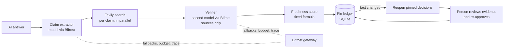

# FreshPin

**A stale-answer detector that knows what depends on the answer.**

FreshPin checks an AI-generated answer claim by claim against the live web (Tavily), scores how fresh each claim is, and, when a fact has changed, **reopens every decision that was approved on the old version** so a person can review it. All model calls go through the Bifrost gateway, with fallbacks across providers and a spend limit on every run.

Built for the Geek Room AI Global Hackathon 2026, for the **"Build a Stale-Answer Detector for AI Applications"** problem statement (Tavily + Bifrost).


---

## The problem

AI answers go out of date quietly. A model trained before a law, a price change or an acquisition will state the old fact with full confidence. The damage isn't the answer alone: people copy it into quotes, checklists, budgets and policies, and those decisions keep running on the old fact after it changes.

Example used in the demo: until 2026, older Dubai buildings had no general periodic safety certificate. **Dubai Law No. 3 of 2026** now requires a building quality and safety certificate once a building is 20 years past completion, and the authorities can suspend lease (Ejari) attestation for buildings that don't comply. An assistant with older training data still says "no certificate needed", and a property manager's maintenance budget and lease checklist were approved on that answer.

## What FreshPin does

1. **Splits the answer into claims.** A model (via Bifrost) extracts atomic, standalone claims, tags their type (pricing, API version, regulation, company, statistic) and decides which are time-sensitive.
2. **Searches the live web.** Tavily searches for the *current* value of each claim. Fast-changing types (prices, versions, company facts) are limited to the last year.
3. **Verifies against sources only.** A second model (via Bifrost) judges each claim using only the sources Tavily returned: `current`, `partly_current`, `stale`, `contradicted` or `unverifiable`. It also states the fact as it stands today and cites the sources it used.
4. **Scores freshness with a fixed formula** (0 to 100), so the same evidence always gives the same score and every point can be explained (see below).
5. **Reopens what depended on it.** Facts are versioned. A stale verdict creates a new version, and every decision pinned to the old version is **reopened**. Unclear evidence marks decisions **at risk** instead. Only a person can re-approve, after confirming they've read the new evidence; the approval is pinned to the new fact version and its evidence hash.

## What's new about it

Most stale-answer checkers stop at a score for each claim. FreshPin adds a **pin ledger**: a record of which approved decisions relied on which version of which fact. "This sentence is outdated" then becomes "these two approvals are now unsafe, here's what changed, and here's who has to sign again". Decisions that relied only on facts that are still current are left alone.

## How Tavily and Bifrost are used

| | Role in FreshPin |
|---|---|
| **Tavily** | Live evidence for every claim: `search_depth: advanced`, recent time range for fast-changing claim types, published dates feed the recency part of the score. |
| **Bifrost** | Every model call goes through Bifrost's OpenAI-compatible endpoint. Each request carries a `fallbacks` list, so a failing provider is replaced automatically. The extractor and verifier use different primary providers. An optional virtual key (`x-bf-vk`) adds gateway-side budgets and rate limits. The UI shows a trace of every call: model asked for, model that served it, tokens, latency, errors. |

**Resilience, in three layers:**
1. **Gateway fallback:** Bifrost retries on the next provider in `fallbacks`.
2. **Client failover:** if Bifrost returns an error for the whole request, FreshPin tries the next model in its own list.
3. **Graceful degradation:** if every model is down, FreshPin still returns the Tavily evidence, marks claims "AI verifier unavailable", and **changes nothing in the ledger**. It never reopens or approves anything on guesswork.

The **Simulate primary model outage** switch in the UI puts a model that will fail at the front of the chain, so you can watch the fallback happen live.

**Spend control:** each run has a token budget (`FRESHPIN_RUN_TOKEN_BUDGET`). Once it is used up, remaining claims are marked unverified instead of making more calls.

## Freshness score

```
score = 0.55 × verdict points   (current 100, partly 60, unverifiable 45, stale 15, contradicted 5)
      + 0.25 × recency points   (age of the newest backing source vs. the claim type's half-life)
      + 0.20 × agreement points (share of sources that back the verdict)
```

Half-lives: pricing 45 days, API versions 60, company facts 120, statistics 180, regulations 240, other 365. Caps: stale or contradicted claims can never score above 35, and claims with no sources can never score above 50. Bands: **fresh** 70 and above, **check** 40 to 69, **stale** below 40. Click "Why N?" on any claim to see the breakdown and every source.

## Architecture



## Run it

FreshPin needs **Python 3.10+** and nothing else: no `pip install`.

### 1. Start Bifrost

```bash
npx -y @maximhq/bifrost        # or: docker run -p 8080:8080 maximhq/bifrost
```

Open http://localhost:8080, add your provider keys (for example OpenAI and Anthropic, or a local model through Ollama), and note the model names you enabled. See the [Bifrost repository](https://github.com/maximhq/bifrost) for details.

### 2. Get a Tavily key

Sign up at [app.tavily.com](https://app.tavily.com).

### 3. Configure and start

```bash
cp .env.example .env           # add TAVILY_API_KEY and the Bifrost model names you enabled
python -m freshpin serve       # http://127.0.0.1:8787
```

The header chips show whether Bifrost is reachable and the Tavily key is set.

### 4. Try it

- Click **Dubai building rules** to load the scenario and its approved decisions, then **Check freshness**.
- Tick **Simulate primary model outage** and check again to see Bifrost's fallback in the trace.
- Open a reopened decision, tick the confirmation, add your name and re-approve.
- Paste any AI answer of your own, then use **Save a new decision that relies on these facts** to pin it.

### Command line

```bash
python -m freshpin sample dubai_building_law      # load a scenario, check it, print a summary
python -m freshpin check "The latest Python release is 3.11."
```

### Offline replay mode and tests

`FRESHPIN_MODE=replay` uses recorded responses from `fixtures/replay.json` (real source URLs, short summarised snippets) so the UI and tests run without keys or internet. The UI shows a banner whenever replay mode is on. Live mode is the real product.

```bash
python -m unittest discover -s tests -v
```

The tests cover the scoring formula, the ledger's reopen and re-approve rules, the full pipeline in replay mode, outage handling and degradation, and the Bifrost client against a fake gateway (fallback detection, failure and budget).

## JSON API

| Method | Path | Body | Returns |
|---|---|---|---|
| GET | `/api/status` | | mode, Bifrost reachability, Tavily key set, models, budget |
| GET | `/api/samples` | | demo scenarios |
| POST | `/api/load_sample` | `{"id"}` | resets the ledger to that scenario |
| POST | `/api/check` | `{"answer", "context", "simulate_outage"}` | claims, verdicts, scores, sources, ledger effects, gateway trace |
| GET | `/api/ledger` | | decisions, pins, facts, audit log |
| POST | `/api/approve` | `{"id", "by", "note"}` | re-approves a decision on current facts |
| POST | `/api/decisions` | `{"title", "by", "owner", "keys"}` | pins a new decision to checked facts |

## Project layout

```
freshpin/
  config.py     settings from env / .env
  llm.py        Bifrost client: fallbacks, client failover, budget, call traces
  search.py     Tavily client
  pipeline.py   extract -> search -> verify -> score -> ledger
  scoring.py    the freshness formula
  ledger.py     versioned facts, decisions, pins, audit log (SQLite)
  replay.py     offline backends for tests
  app.py        wiring for the UI and CLI
  server.py     standard-library HTTP server + JSON API
web/index.html  the UI (no build step, no external assets)
samples/        demo scenarios and their seeded decisions
fixtures/       recorded responses for replay mode
tests/          unittest suite
```

## Limits

- Verdicts depend on what Tavily finds. When sources are thin or undated, FreshPin says so (the "check" band, "unverifiable") rather than guessing, and it never reopens a decision on unclear evidence.
- Claim keys are produced by the extractor model and matched to known facts; two different wordings of the same fact can occasionally get different keys.
- The demo ledger is a local SQLite file. A production version would sit next to the systems where decisions live (CRM, ERP, document approvals).

## Built during the hackathon, and use of AI tools

The FreshPin code was written during the hackathon period. The idea of pinning approvals to fact versions comes from the author's earlier work on back-office software; no code from that project was used.

AI tools were used in development: Claude (Anthropic) helped write code, tests and documentation. At runtime FreshPin uses whichever models you enable in Bifrost, plus Tavily search.

## License

MIT. See [LICENSE](LICENSE).
